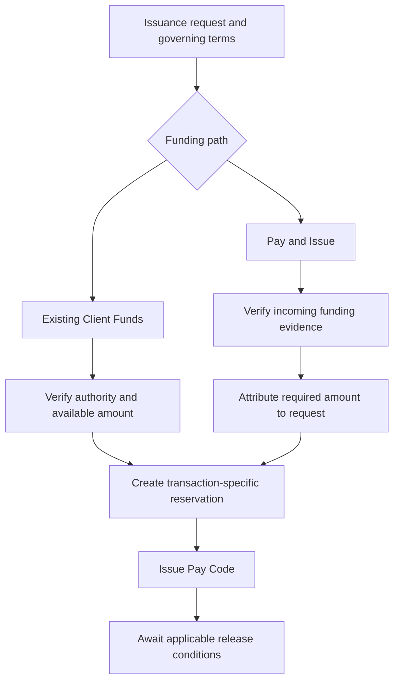
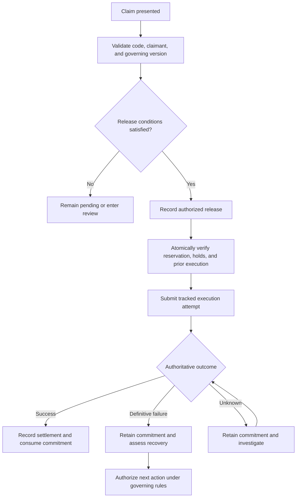

# Digital Escrow as a Bank-Operated Conditional Settlement Service

## A Product and Architecture Thesis for x-change

- Status: Initial research outline; sections pending development.
- Date: 2026-11-03.
- Document type: Research-style position paper and product thesis.
- Evidence status: No empirical study or completed legal classification is claimed.
- Working model: A bank offers and operates the product; ODTI licenses x-change and provides separately agreed implementation or support services.

## Drafting Discipline

Develop each section separately. Distinguish documented facts, assumptions,
architectural proposals, hypotheses, and unresolved questions. Cite primary
sources for legal propositions and versioned package evidence for implementation
claims. Record observations only when supported by identifiable evidence.

The term "digital escrow" is a working product concept. It does not establish
institutional authority, legal segregation, regulatory exemption, or the legal
character of a Pay Code. This paper is not legal advice or a compliance opinion.

## 1. Abstract

Financial transactions frequently require an interval between committing funds and authorizing payment. Faster transfer infrastructure does not independently resolve the conditions, evidence, and decisions governing that interval. This paper proposes a bank-operated digital escrow service powered by x-change, a licensed settlement operating system.

The conceptual model centers on a funded conditional obligation. Customers would either commit existing Client Funds or fund a specific issuance request through a Pay and Issue workflow. A Pay Code would identify or provide access to the associated settlement instruction, with payment governed by explicit release conditions and online authorization. The proposed service would not require customers to maintain a reusable platform spending balance.

The paper draws on selected regulatory sources, founder-authored monographs, and x-change documentation to develop the framework and a prospective evaluation method. Five hypotheses address customer utility, architectural fit, operational integrity, bank operability, and commercial feasibility. The method combines documentary research, requirements mapping, transaction scenarios, stakeholder inquiry, and a proposed controlled pilot.

The reviewed materials identify relevant architectural foundations, but a complete product-specific implementation assessment and empirical evaluation remain outstanding. All five hypotheses are unresolved. Legal characterization depends on the actual agreements, institutional roles, and operation; transaction-specific funding alone does not establish escrow status or regulatory exemption.

The paper contributes an examinable product model and validation agenda. Further work should select an initial use case, define the bank’s undertaking, establish institutional arrangements, and evaluate the resulting service against explicit criteria.

**Keywords:** digital escrow; conditional settlement; Pay Code; transaction-specific funding; banking; x-change; legal architecture.

## 2. Introduction

### 2.1 Payment Instructions and the Separation of Intent from Settlement

The use of instructions to arrange payment long predates digital finance. Checks illustrate a durable distinction: a person can communicate an instruction to pay without physically delivering cash at the same moment. Issuance, presentation, verification, and eventual payment are separate events. This separation provides a useful starting point for examining digital escrow.

Three practical concerns motivate this paper. The first is timing: an obligation may be created before payment should occur. The second is logistics: parties may transact across distance without transporting currency themselves. The third is security: payment should depend on established authority and appropriate verification. These concerns remain relevant even where electronic transfers can move funds almost immediately.

Financial institutions perform an essential coordinating role within this separation. They receive and authenticate instructions, establish whether payment is authorized, and arrange execution through their accounts and settlement infrastructure. The instruction expresses an intended financial action; the institution determines whether and how that action may proceed.

### 2.2 From Faster Transfers to Governed Obligations

The conceptual foundation of this study derives from Lester B. Hurtado’s x-change monographs. In *When Money Adapts to People*, Hurtado interprets the paper check as an example of separating a financial obligation from its eventual settlement. That interpretation motivates an architectural question: can a financial instruction remain useful while the means of presenting, verifying, and executing it become digital? [Hurtado, ](https://3neti.com/insights/when-money-adapts-to-people)[*When Money Adapts to People*](https://3neti.com/insights/when-money-adapts-to-people)

The companion essay, *x-change: A Founder’s Update*, describes how a practical disbursement problem developed into a broader concern with entitlement, evidence, approvals, and exceptions. Its central observation is that the transfer itself represents only one stage of a financial obligation’s lifecycle. This paper adopts that observation as a research premise rather than an independently established finding. [Hurtado, ](https://3neti.com/insights/x-change-a-founders-update)[*x-change: A Founder’s Update*](https://3neti.com/insights/x-change-a-founders-update)

The distinction matters because transfer speed cannot determine whether a recipient has become entitled to payment. A transaction may require delivery, inspection, identity verification, documentary presentation, or another agreed event. Faster execution helps after authority has been established; a separate mechanism must govern the conditions preceding it.

### 2.3 Digital Escrow as a Product Hypothesis

This paper proposes a bank-operated digital escrow service built around transaction-specific funding and explicit release conditions. A customer would fund a particular transaction, and the bank would administer the associated obligation under an agreement identifying the relevant parties, their rights, and the conditions governing payment or return of funds.

A Pay Code would identify or provide access to the associated settlement instruction. Its presentation would initiate the required verification process. Possession of the code alone would not override the agreement’s release conditions.

The proposed “Pay and Issue” path would allow a customer to fund a specific instruction without first maintaining a reusable platform spending balance. A separate path could reserve existing Client Funds against an instruction. Both paths require an explicit account of funding, entitlement, reservation, release authority, settlement, and the disposition of unresolved funds.

This proposal uses digital escrow as a working product concept. Whether a particular implementation constitutes escrow, another banking service, or overlapping regulated activities must be evaluated from its actual agreements, institutional roles, and operation.

### 2.4 Institutional Ownership and Architectural Responsibility

Under the proposed model, the participating bank owns and operates the financial product. It establishes the customer agreement, administers the funds, governs release decisions, and assumes the obligations assigned to it by the applicable arrangement. ODTI licenses x-change and supplies implementation or support services within separately defined responsibilities.

The resulting architecture must connect each instruction to its funding evidence, governing conditions, approvals, execution result, and accounting records. It must also explain what happens when a transaction expires, is cancelled, becomes disputed, or cannot be completed. These relationships form part of the product itself: they determine whether the institution can explain and reconstruct its actions.

### 2.5 Purpose and Contribution of the Study

This study investigates whether x-change can support an accessible bank-operated digital escrow service while preserving institutional control, transaction-specific accountability, and auditable settlement. It examines the relationship between established financial practices and the proposed digital lifecycle, identifies architectural and contractual gaps, and develops criteria for subsequent evaluation.

The intended contribution is a product and architecture thesis that can be challenged through documentary research, bank assessment, legal analysis, customer inquiry, and controlled operational evidence. Its central proposition is that modern financial infrastructure can improve how obligations are governed, alongside improving how quickly funds move.

## 3. Research Questions and Objectives

### 3.1 Central Research Question

Can a bank-operated service use transaction-specific funding, explicit release conditions, and auditable settlement instructions to provide useful digital escrow functionality without requiring customers to maintain a reusable platform spending balance?

This question connects the proposed customer experience with the institutional obligations necessary to support it. Its investigation requires examining how funds are received and administered, how payment authority is established, and how the rights of the parties change throughout the transaction.

### 3.2 Supporting Research Questions

**Financial relationship.** When a customer pays for a Pay Code, what obligation does the bank assume? Does it hold funds as an escrow agent, issue a payment undertaking, or enter another identifiable arrangement? Who is entitled to the funds before release, and how does that entitlement change upon settlement, cancellation, expiry, or dispute?

**Conditions and authority.** Which events authorize release, and who may establish that those events occurred? How should the service distinguish identity verification, contractual performance, customer approval, and the bank’s authorization to execute payment?

**Transaction-specific funding.** Can each issuance remain tied to identifiable funding and a defined obligation throughout its lifecycle? Can excess payments, refunds, and failed transactions be resolved without creating an unintended reusable spending balance?

**Institutional roles.** What responsibilities belong to the product-operating bank, any separate escrow or settlement institution, and ODTI? What authority and contractual arrangements does each proposed role require?

**Architectural adequacy.** Which requirements can the documented x-change architecture support, and which require further development? Can the system prevent conflicting uses of committed funds, handle uncertain settlement outcomes, and preserve a complete explanation of each transaction?

**Customer and commercial value.** Which customers would benefit from the service, and for which transactions? Would its convenience, protection, cost, and accessibility justify adoption compared with existing alternatives?

### 3.3 General Objective

To develop and evaluate a product and architecture model for bank-operated digital escrow powered by x-change, with explicit treatment of customer rights, institutional responsibilities, funding, conditional release, settlement, and evidence.

### 3.4 Specific Objectives

1. Define the proposed service and its intended customer use cases.
2. Compare its obligations with those arising under escrow and related banking instruments.
3. Model the lifecycle from funding and issuance through settlement or another authorized disposition.
4. Identify the custody, entitlement, authority, and accounting relationships at each stage.
5. Map product requirements to documented x-change capabilities and identify gaps.
6. Evaluate normal and adverse scenarios, including disputes, duplicate claims, expiry, cancellation, and uncertain provider outcomes.
7. Establish criteria for customer research, bank assessment, legal review, and a controlled pilot.
8. Identify evidence that would support, require revision of, or contradict the proposed model.

### 3.5 Standard of Evaluation

The study will treat product usefulness, architectural adequacy, operational integrity, and legal characterization as related but distinct subjects of evaluation. Evidence supporting one does not automatically establish the others.

A technically successful demonstration would show that a defined workflow can execute under specified conditions. Customer research would address whether that workflow solves a meaningful problem. Institutional and legal review would address the proposed roles, obligations, and authority. Operational evidence would be needed to assess reliability and control in practice.

The research must remain open to alternative outcomes. Digital escrow may prove suitable for some use cases, while others may be better structured as a different bank payment service. Either result would advance the study if supported by clear reasoning and evidence.

## 4. Review of Related Literature and Regulatory Sources

### 4.1 Intellectual Foundation: Financial Obligations Before Settlement

Hurtado’s x-change monographs provide the conceptual starting point for this study. *When Money Adapts to People* interprets the check as an instruction that separates the creation of an obligation from its eventual settlement. *x-change: A Founder’s Update* develops the related proposition that entitlement, evidence, approvals, and exceptions form a lifecycle surrounding payment. Together, these essays motivate an architecture in which the obligation and its governing conditions remain explicit before execution occurs. [Hurtado, *When Money Adapts to People*](https://3neti.com/insights/when-money-adapts-to-people), [Hurtado, *x-change: A Founder’s Update*](https://3neti.com/insights/x-change-a-founders-update)

The monographs are founder-authored conceptual sources. Their role in this study is to explain the origin and intended direction of the architecture. Their claims about customer needs, market opportunity, and operational effectiveness require evaluation through additional sources and empirical evidence.

### 4.2 Escrow as Conditional Administration of Entrusted Property

BSP Circular No. 609 describes escrow within its Financial Reporting Package for Trust Institutions. Its definition concerns agency agreements under which a trust institution holds money, securities, or property deposited by a principal, with eventual delivery to a third party contingent on an event or an action by the principal, the third party, or both. [BSP Circular No. 609, item (6), “Escrow”](https://www.bsp.gov.ph/Regulations/Issuances/2008/c609.pdf)

For this study, the definition identifies a relationship among entrusted property, an administering institution, an intended recipient, and a release condition. It provides a basis for examining the proposed product’s agreements and lifecycle. Its reporting context must also be preserved: the definition alone does not determine the classification or permitted provider of every conditional payment service.

An architectural reservation records that an amount has been committed to an obligation. Whether that reservation implements an escrow arrangement depends on the underlying rights and duties. The research must therefore examine both the accounting representation and the agreement that gives it meaning.

### 4.3 Related Instruments: Instructions, Undertakings, and Documentary Conditions

Checks, manager’s checks, money orders, documentary credits, and guarantees provide useful comparisons because each connects an instruction or undertaking with an eventual payment. Their differences concern who owes payment, the conditions of that obligation, and the recipient’s rights.

Documentary credits illustrate a bank undertaking linked to the presentation of stipulated documents. The United States International Trade Administration describes a letter of credit as a bank commitment to pay when its specified terms are met through the required documentary presentation. This mechanism distinguishes documentary compliance from a general determination that the underlying commercial relationship has been satisfactorily performed. [International Trade Administration, *Letters of Credit and Documentary Collection*](https://legacy.export.gov/article2?id=Letters-of-Credit-and-Documentary-Collection)

Demand guarantees introduce another distinction. Under the ICC framework for guarantees subject to URDG 758, the guarantor’s undertaking is independent of the underlying relationship and responds to a complying demand. Those rules apply when incorporated into the instrument; they should not be assumed to govern every bank guarantee. [ICC Academy, *Understanding Demand Guarantees: A Guide to URDG 758*](https://academy.iccwbo.org/trade-finance/article/understanding-demand-guarantees-urdg-758-guide/)

These comparisons suggest that the study must specify whether a proposed Pay Code represents access to entrusted funds, evidence of a bank undertaking, or an instruction operating under another arrangement. Manager’s checks and money orders remain subjects for further Philippine source review before detailed legal comparisons are drawn.

### 4.4 Transaction-Specific Funding and E-Money

The proposed service distinguishes funding a particular obligation from maintaining a reusable platform spending balance. That distinction is relevant to product design, but it cannot independently determine regulatory treatment.

BSP Circular No. 1166 defines e-money through several characteristics involving the account, prefunding, acceptance, issuance against received funds, the claim on the issuer, and withdrawal or transfer functionality. Evaluation therefore requires examining the complete arrangement rather than relying on the presence or absence of the word “wallet.” [BSP Circular No. 1166](https://www.bsp.gov.ph/Regulations/Published%20Issuances/Images/Circular_1166.pdf)

For this thesis, transaction-specific funding is an architectural proposition to test. The analysis must consider cancellation, refunds, residual amounts, transferability, and repeated use, since those features may affect the practical character of the service. Calling an arrangement escrow does not itself establish that e-money rules are inapplicable.

### 4.5 Philippine Institutional Authority and Allocation of Roles

The General Banking Law provides a statutory basis for examining the powers and responsibilities of the institutions involved. Section 79 addresses authority to engage in trust business, while Section 80 addresses the administration of property under a trust entity’s custody. These provisions make the administering institution’s role a substantive research question. [Republic Act No. 8791, Sections 79–80](https://elibrary.judiciary.gov.ph/thebookshelf/showdocs/2/5339)

The proposed architecture must distinguish the bank offering the product, any institution accepting the escrow appointment, the bank holding an underlying deposit, and the provider executing payment. Those roles may coincide, but the research should establish their allocation through the actual agreements and operating arrangements.

ODTI’s proposed role is software licensing and separately contracted implementation or support. The study must assess how the bank’s authority, operational control, and customer obligations remain explicit when technology and services are supplied by other parties.

### 4.6 Comparative Experience

California demonstrates one approach to independent escrow businesses. Its Department of Financial Protection and Innovation administers an escrow licensing framework, while banks and certain other providers are addressed through applicable exemptions and other regulatory regimes. This illustrates differentiation among provider types rather than an absence of oversight. [California DFPI, *About the Escrow Law*](https://dfpi.ca.gov/regulated-industries/escrow-law/about-the-escrow-law/)

United Kingdom guidance offers a separate comparison. The Solicitors Regulation Authority describes third-party managed accounts used for escrow payment services, while FCA guidance addresses safeguarding obligations for relevant payment institutions. These sources help distinguish contractual administration of a transaction from protections applying to customer funds held by payment providers. [SRA, *Third-Party Managed Accounts*](https://www.sra.org.uk/solicitors/guidance/third-party-managed-accounts/), [FCA, *Safeguarding Requirements*](https://www.fca.org.uk/firms/emi-payment-institutions-safeguarding-requirements)

These examples provide comparative questions about custody, institutional authority, fund protection, and release control. They do not establish permission to operate an equivalent arrangement in the Philippines.

### 4.7 Synthesis and Research Gap

The reviewed materials identify several ways institutions coordinate payment: administering entrusted property, executing customer instructions, or issuing undertakings governed by specified presentation requirements. The proposed digital escrow product must identify which relationship it creates and preserve that relationship throughout its technical lifecycle.

The research gap addressed by this thesis is specific to the proposed x-change model: whether its settlement architecture can support a bank-owned service combining transaction-specific funding, explicit release conditions, recipient access, and traceable disposition of funds.

This is a proposed contribution to be evaluated. The present review does not establish that comparable products are absent, that the market is unserved, or that the legal characterization has been resolved. Further work must register source versions, check amendments, examine competing products, and connect the resulting findings to the proposed operating model.

## 5. Conceptual Framework

### 5.1 Unit of Analysis: The Funded Conditional Obligation

The central unit of this framework is a funded obligation governed by identifiable instructions and release conditions. Each obligation connects a funding principal, an intended recipient or recipient eligibility rule, an amount, an administering institution, and an authorized means of disposition.

Funding, issuance, release authorization, and settlement are distinct events. Funds may have been received while issuance remains incomplete. A Pay Code may have been issued while its release conditions remain unsatisfied. Payment may have been authorized while its execution remains pending or uncertain.

The framework preserves these distinctions so that a customer-facing status does not substitute for evidence of funding, authority, or completed settlement.

### 5.2 Actors and Institutional Roles

The **funding principal** supplies funds or authorizes the commitment of an existing position. Funding does not, by itself, determine the principal’s continuing right to cancel or recover the amount. Those rights must follow the governing arrangement.

The **recipient** is the person entitled to receive payment when the applicable conditions are satisfied. Recipient identification may occur at issuance or through a subsequently authorized process. Eligibility and identity must remain distinguishable: identifying a claimant does not necessarily establish entitlement.

The **product-operating bank** offers the service, establishes its terms, and governs its operation. Where it also accepts the escrow appointment, the agreement must identify its corresponding responsibilities. If another institution performs that role, the allocation must be explicit.

The **settlement institution or provider** executes the authorized movement of funds. It may be the product-operating bank or a separate institution. Its execution records supply evidence of payment outcomes within the agreed integration and reconciliation arrangements.

An **authorized verifier or decision-maker**, where required, establishes whether a release condition has been satisfied or resolves a disputed instruction. The agreement must define that party’s authority and the evidence on which it may act.

**ODTI** licenses x-change and supplies separately agreed services. Under this proposed model, a software license does not appoint ODTI as custodian, escrow agent, or decision-maker for customer transactions. Any additional operational role must be expressly identified and assessed.

### 5.3 Funding, Custody, and Treasury Attribution

The framework distinguishes three questions:

1. Where are the underlying funds held?
2. To whom are those funds attributable, and under what arrangement?
3. What amount is currently committed to a particular obligation?

A Treasury Position represents an internal attribution of value. A reservation records a restriction on its availability for competing uses. Neither record alone establishes ownership, a trust relationship, or protection against claims by third parties.

The bank’s account structure and agreements must explain the relationship between the underlying funds and the internal records. Reconciliation must preserve that relationship throughout funding, issuance, settlement, and any subsequent correction.

### 5.4 Two Funding Paths

The proposed service accommodates two conceptual paths.

**Existing Client Funds.** A customer authorizes the commitment of an available Client Funds position to a defined obligation. The system records the corresponding reservation and associates it with the issuance request and Pay Code.

**Pay and Issue.** A customer supplies funds for a particular issuance request. The bank verifies the receipt, attributes the required amount to that request, and commits it to the associated obligation. This path does not require the customer to maintain a reusable platform spending balance.

Both paths converge on a funded obligation:

```text
Existing Client Funds -> Authorized reservation -----------+
                                                          |
Pay and Issue -> Verified receipt -> Specific allocation --+
                                                          |
                                                          v
                                                Funded obligation
                                                          |
                                                          v
                                                  Pay Code issued
                                                          |
                                                          v
                                            Release conditions evaluated
                                                          |
                                                          v
                                             Authorized online settlement
                                                          |
                                                          v
                                           Outcome recorded and reconciled
```

The sequence describes the proposed product model. It does not assert that every step or exception is already implemented.

### 5.5 Pay Code and Release Authority

The Pay Code identifies or provides access to the associated settlement instruction. Its presentation allows the service to locate the obligation and begin the applicable claim and verification process.

Release authority depends on the governing conditions. These may include recipient identity, documentary evidence, approval by a designated party, a specified date, or another verifiable event. A deployment must state which conditions apply and how they are evaluated.

Identity checks, mobile verification, OTP, location, selfie, and signature may contribute evidence where appropriate. Their evidentiary purpose must be defined. For example, successful OTP verification may support control of a mobile number without establishing that goods were delivered.

Conditions and amendments must be versioned. A party must not be able to change the basis of an outstanding obligation merely by editing its current configuration.

### 5.6 Lifecycle and Exceptional Outcomes

The lifecycle should track funding, obligation status, and payment execution separately. An obligation can remain funded and reserved while a dispute is open or a provider outcome is uncertain.

A proposed normal lifecycle is:

```text
Request -> Funding verified -> Funds committed -> Issued
        -> Conditions satisfied -> Release authorized
        -> Execution submitted -> Settlement confirmed -> Closed
```

Alternative outcomes require explicit treatment:

| Event | Required determination |
|---|---|
| Cancellation | Who may cancel, at what stage, and with whose consent? |
| Expiry | Does the claim window end, and what happens to the funds and obligation? |
| Dispute | Who may place a hold, resolve the dispute, and authorize disposition? |
| Failed execution | Is failure definitive, and may payment safely be retried? |
| Uncertain execution | What evidence is needed before retrying, refunding, or releasing the reservation? |
| Excess or unmatched funding | To whom is it attributable, and how may it be returned or otherwise resolved? |
| Reversal after payment | What new accounting and recovery obligations arise? |

Expiry of a code must not be assumed to extinguish entitlement to the underlying funds. Likewise, a technical timeout must not be treated as proof that payment failed. The arrangement and authoritative evidence must determine the next action.

### 5.7 Traceability and Proposed Invariants

Each obligation should connect its governing agreement and instruction version to funding evidence, reservations, condition evaluations, approvals, execution attempts, final outcomes, and accounting entries.

The framework proposes the following invariants for subsequent evaluation:

1. The same committed amount cannot remain available for competing obligations.
2. Funding evidence cannot independently authorize release.
3. Presentation of a Pay Code cannot bypass its governing conditions.
4. A retry cannot create a second fulfillment of the same authorized obligation.
5. Uncertain execution cannot automatically release committed funds.
6. Every release, refund, or adjustment requires identifiable authority and evidence.
7. Fees and residual amounts have an explicit accounting and contractual disposition.
8. Every completed transaction can be reconstructed and reconciled.

These are proposed product requirements. Later sections must establish which are supported by existing capabilities and what evidence is needed to demonstrate them.

### 5.8 Boundary of the Framework

The framework describes a proposed bank-operated conditional settlement service. Its usefulness does not depend on assuming that every Pay Code is an escrow instrument.

The resulting agreements and operating arrangements may support an escrow characterization for particular products. Other products may create a different bank payment undertaking. The framework preserves the information needed to examine that distinction while providing a common architectural basis for funding, conditions, authority, execution, and evidence.

## 6. Hypotheses and Evaluation Criteria

### 6.1 Purpose of the Hypotheses

The proposed service combines several propositions: that customers need it, that x-change can support it, that banks can operate it reliably, and that its economics justify adoption. These propositions require different evidence and may produce different results.

The hypotheses below organize that evaluation. They are working propositions for an exploratory study. They do not represent established findings or statistical conclusions. Quantitative thresholds, sample sizes, and observation periods must be specified before collecting the evidence used to judge them.

### 6.2 H1: Customer Utility

**Hypothesis.** For selected transactions requiring delayed or conditional payment, customers can obtain meaningful value from a bank-operated service that combines transaction-specific funding, a Pay Code, and explicit release conditions without requiring a reusable platform spending balance.

Evaluation should compare the proposed experience with the alternatives customers actually use. Relevant measures include task completion, time and effort, total cost, understanding of release and refund rules, and willingness to use the service for another transaction.

Support would require evidence that a defined customer group experiences a material improvement against a specified alternative. The proposition would require revision if customers cannot understand the arrangement, find the conditions burdensome, or obtain equivalent benefits more conveniently elsewhere.

Access without a reusable spending balance must be evaluated separately from access without registration, identification, or an existing bank relationship. Those are distinct product features.

### 6.3 H2: Architectural Fit

**Hypothesis.** The documented x-change architecture provides a reusable foundation for the proposed service, with identifiable and bounded extensions.

Evaluation should map each product requirement to documented design, implementation evidence, and demonstrated behavior. The mapping must distinguish existing capabilities, configurable capabilities, required extensions, and unresolved design questions.

Support would require a coherent implementation path that preserves the distinction among funding, reservation, release authority, execution, and settlement. The proposition would be weakened if essential requirements depend on extensive manual reconstruction or changes that contradict the existing architecture.

The presence of similarly named components is insufficient evidence. A reservation component, for example, must be evaluated against the specific concurrency, release, and recovery requirements of the proposed product.

### 6.4 H3: Operational Integrity

**Hypothesis.** Within a defined operating scope, the proposed controls can preserve attributable funding, prevent unauthorized or duplicate fulfillment, and maintain reconcilable records through normal and adverse transaction scenarios.

Evaluation should include concurrent claims, repeated requests, duplicate funding notifications, provider timeouts, delayed confirmations, definitive failures, disputes, cancellations, expiry, and recovery after interruption.

For the evaluated scenarios, acceptance requires no unexplained duplicate settlement, unauthorized release, or reuse of committed funds. Every tested obligation must remain attributable and reconstructable, including those left unresolved.

An observed control failure would contradict the relevant control proposition for that version and scope. Conversely, successful testing would provide bounded evidence; it would not establish that fraud or failure is impossible.

### 6.5 H4: Bank Operability

**Hypothesis.** A participating bank can govern the service through explicit roles, controlled access, documented procedures, and sufficient operational evidence while retaining ownership of its customer obligations.

Evaluation should examine issuance approval, release decisions, disputes, refunds, reconciliation, incident response, and continuity. Bank personnel should be able to explain and perform the evaluated procedures using the agreed tools and documentation.

Support would require clear decision authority and demonstrated handling of representative cases. The proposition would require revision if routine operation depends on undocumented intervention by individual developers or if responsibility for unresolved transactions cannot be assigned.

This hypothesis concerns operational capability. Institutional authority remains a separate question.

### 6.6 H5: Commercial Feasibility

**Hypothesis.** For a defined customer segment and transaction profile, the service can deliver customer value at a price that covers its attributable operating costs and supports sustainable bank operation.

Evaluation should account for payment-provider charges, infrastructure, licensing, customer support, identity verification where applicable, reconciliation, disputes, fraud losses, and exception handling.

Support would require a credible contribution margin under stated volume and usage assumptions. Sensitivity analysis should examine lower adoption, higher support demand, longer holding periods, and more frequent disputes.

The proposition would be weakened if viability depends on unsupported transaction forecasts, unpriced manual work, or income from held funds that the proposed arrangement does not permit.

### 6.7 Legal and Institutional Questions

Legal characterization will be evaluated through reasoned analysis of the actual agreements, institutional roles, and applicable authorities. It will not be treated as a statistical hypothesis or inferred from technical success.

The review must address whether the proposed arrangement constitutes escrow, another payment undertaking, or overlapping activities; which institution may perform each role; and what customer rights follow.

A finding that a particular structure is unsuitable would require revision of that structure. It would not necessarily invalidate the broader customer need or the usefulness of the settlement architecture.

### 6.8 Evaluation Design and Decision Rules

Before empirical evaluation begins, the study should specify:

1. The product version, institution, customer segment, and transaction scenarios under evaluation.
2. The comparison service or existing customer practice.
3. Measures, acceptance thresholds, sample selection, and observation period.
4. Evidence sources and responsibility for recording outcomes.
5. Treatment of failed, abandoned, disputed, and unresolved transactions.
6. Conditions requiring suspension, redesign, or further investigation.

Results should be reported as supported within the evaluated scope, contradicted, or unresolved. Missing evidence must remain visible. Acceptance thresholds should not be changed after observing results without documenting the change and its implications.

### 6.9 Relationship Among Findings

The hypotheses form a cumulative assessment rather than a single pass-or-fail score. Customer demand may exist while the implementation remains incomplete. A technically sound system may prove commercially unattractive. A viable product may require a different institutional arrangement from the one initially proposed.

The study should preserve these distinctions so that each finding leads to an identifiable decision: continue, refine, narrow the scope, change the operating model, or discontinue a particular proposition.

## 7. Assumptions and Scope

### 7.1 Status of the Assumptions

The study uses a defined operating model to make the proposed service examinable. Its assumptions identify the conditions under which the architecture and hypotheses will be evaluated. They are not findings.

Each material assumption should eventually be linked to supporting evidence, an accountable reviewer, or a question requiring resolution. If an assumption changes, the study must identify the affected requirements, analyses, and conclusions.

### 7.2 Bank Ownership and Operation

The proposed product is offered and governed by a participating bank. The bank establishes its customer agreements, approves product rules, controls operational authority, and administers the obligations allocated to it.

ODTI licenses x-change and supplies separately agreed implementation, maintenance, training, or support. The model assumes that these services can be provided while preserving the bank’s control over financial decisions and production access.

Bank ownership concerns substantive responsibility and control. Hosting location, branding, and possession of source code may support that control, but do not individually establish it.

### 7.3 Institutional Authority and Legal Arrangement

The study does not assume that a bank’s existing permissions necessarily cover every proposed feature. The institution’s authority must be evaluated against the actual custody, agency, payment, and other roles contemplated.

The term digital escrow remains a working product description. Its suitability depends on the resulting agreements and operation. Alternative characterizations remain open where the evidence supports them.

No assumption is made that the service falls outside e-money or other applicable frameworks merely because customers do not maintain a reusable spending balance.

### 7.4 Customers and Access

The proposed customer population may include depositors and non-depositors, subject to the participating bank’s permitted onboarding and service arrangements.

Access without an existing deposit relationship does not imply anonymous access. Identity, eligibility, screening, and documentary requirements must be defined for the selected use case.

The initial evaluation should identify a specific customer segment and transaction purpose. Findings from that scope should not automatically be generalized to all retail, commercial, or public-sector payments.

### 7.5 Funding and Availability

The initial model concerns funded obligations. Funding may originate from an existing Client Funds position or from a payment attributable to a particular issuance request.

The service must establish when funding is sufficiently verified to support issuance and subsequent release. An incoming notification or customer-provided receipt does not, by itself, establish that standard.

Committed amounts must remain distinguishable from available amounts. Fees, excess receipts, unmatched funding, and residual amounts require explicit treatment.

The Pay and Issue path assumes no requirement for a reusable platform spending balance. Whether actual product behavior preserves that assumption remains subject to evaluation.

### 7.6 Custody and Settlement Infrastructure

The operating bank may use its own account and payment infrastructure or an agreed arrangement with a separate settlement institution.

The study does not assume that NetBank or another named provider offers every account structure, escrow appointment, or operational capability required. Those capabilities must be confirmed for the proposed arrangement.

Internal Treasury attribution must remain distinguishable from the underlying custody structure. The framework does not presume that a reservation creates a separate bank account or legally segregated property.

### 7.7 Release Conditions and Online Settlement

Each obligation must have identifiable release conditions and an authorized process for evaluating them. Conditions may range from recipient verification to documentary presentation or approval by a designated party.

The study does not assume that software can independently establish every real-world fact. Where human judgment or external evidence is necessary, the responsible party and decision process must be specified.

Pay Codes may be communicated or presented through channels that do not themselves require connectivity. Authorization and settlement, however, require online validation against the authoritative operating system and applicable provider evidence.

### 7.8 Exceptions and Continuing Obligations

The evaluated scope includes cancellation, expiry, disputes, failed execution, uncertain execution, refunds, and reconciliation exceptions.

A change in technical status must not silently determine a party’s rights. Code expiry, for example, requires an explicit rule for the continuing obligation and disposition of funds.

The study assumes that unresolved transactions remain visible and attributable until an authorized disposition is recorded. Manual intervention, where necessary, must preserve evidence and accountability.

### 7.9 Initial Exclusions

The initial product thesis does not evaluate:

1. Lending, credit underwriting, or advances against expected escrow proceeds.
2. Investment management or a business model dependent on returns from held funds.
3. Cross-border payments, foreign exchange, or multiple currencies.
4. Negotiability, unrestricted transfer, or secondary trading of Pay Codes.
5. Offline authorization or offline settlement.
6. Universal support for every bank, payment provider, or transaction type.

These exclusions define the first research scope. A later extension requires its own assumptions, institutional assessment, and evaluation criteria.

### 7.10 Evidence and Generalization

The initial paper is a product and architecture thesis. Documentary sources, demonstrations, interviews, and pilot observations provide different kinds of evidence and must be reported accordingly.

Prototype success does not establish production reliability. A bounded pilot does not establish suitability at unrestricted scale. Founder accounts explain the origin and intended direction of the system but do not independently verify its effectiveness.

Conclusions must identify the product version, institutional arrangement, transaction scope, and evidence on which they depend.

## 8. Methodology

### 8.1 Research Design

The study will use an exploratory design combining documentary research, architecture analysis, transaction scenarios, stakeholder inquiry, and a proposed controlled pilot.

The unit of analysis is the funded conditional obligation described in Section 5. Evaluation will examine how that obligation is created, funded, governed, fulfilled, or otherwise resolved.

The methods address different questions. Documentary research examines institutional roles and applicable authorities. Architecture analysis evaluates implementation feasibility. Stakeholder inquiry examines customer utility and bank operability. A controlled pilot, if authorized, would provide bounded operational and commercial evidence.

### 8.2 Documentary Research

Sources will be selected for their relevance to the proposed arrangement and evaluated under the package’s Source Evaluation Protocol and Research Workflow.

The review will prioritize statutes, official regulatory issuances, judicial decisions, and authoritative instrument rules. Institutional product materials and scholarly or professional commentary may supply context, with their evidentiary limits identified.

Each material source should record its issuer, publication date, version, relevant provision, applicability, subsequent amendments, and retrieval date. Historical materials may explain development but must not automatically be treated as current authority.

The analysis will preserve competing interpretations and distinguish an express requirement from an inference. A source’s general relevance does not establish its application to a particular bank or deployment.

### 8.3 Architecture and Requirements Mapping

The study will establish a versioned baseline of x-change documentation and relevant implementation evidence.

Each product requirement will be mapped to its supporting design, implementation component, available evidence, and remaining gap. Capability status will distinguish:

1. Proposed.
2. Documented.
3. Implemented with supporting evidence.
4. Demonstrated under specified conditions.
5. Observed in an authorized operating environment.

These statuses describe different levels of support. They must not be collapsed into a general claim that the product is ready.

The mapping will connect business requirements, legal questions or applicable authorities, proposed invariants, software components, and evaluation evidence. Where a relationship remains unresolved, that gap will remain explicit.

### 8.4 Transaction Scenario Analysis

Scenarios will examine both funding paths and the lifecycle defined in Section 5.

For each scenario, the study will specify the initial state, actors, governing instruction, funding evidence, release conditions, permitted actions, expected outcome, and accounting consequences.

Normal scenarios will be supplemented by adverse and boundary cases, including duplicate requests, simultaneous claims, unmatched funding, cancellation, expiry, disputes, interrupted processing, delayed provider confirmation, and uncertain execution.

Scenario walkthroughs will identify design problems. Executed tests or demonstrations, when separately undertaken, will provide evidence of behavior for the evaluated version and environment. A walkthrough alone will not be reported as a successful execution.

### 8.5 Stakeholder Inquiry

Customer inquiry will investigate existing practices, transaction difficulties, understanding of the proposed service, acceptable costs, and willingness to adopt.

Bank inquiry will examine product ownership, operational roles, integration constraints, approval processes, reconciliation, support, and exception handling. External counsel will assess the proposed agreements, characterizations, and institutional questions within an agreed review scope.

Participant selection, interview questions, and analysis methods will be documented before formal inquiry. Early exploratory conversations may inform the design but will be distinguished from systematically collected findings.

The study will record disagreement and negative feedback alongside favorable responses.

### 8.6 Controlled Pilot Proposal

A pilot would proceed only under the participating institution’s applicable authorization and approval arrangements. This paper does not authorize live transactions.

The proposal will define the institution, customer segment, permitted use cases, software version, transaction limits, release conditions, operating period, and responsible personnel.

It will also specify monitoring, reconciliation, support, incident handling, suspension criteria, and the disposition of outstanding obligations when the pilot ends.

Pilot evidence should include successful, failed, abandoned, disputed, and unresolved cases. Reporting only completed payments would provide an incomplete account of performance.

### 8.7 Measures and Analysis

Measures will be selected against the hypotheses in Section 6.

| Evaluation area | Illustrative measures |
|---|---|
| Customer utility | Completion rate, time, effort, comprehension, cost, and repeat-use intention |
| Architectural fit | Requirement coverage, unresolved dependencies, and extent of required extensions |
| Operational integrity | Unauthorized actions, duplicate fulfillment, reconciliation exceptions, and recovery outcomes |
| Bank operability | Staff task completion, escalation frequency, manual effort, and case resolution |
| Commercial feasibility | Revenue, attributable costs, support burden, losses, and contribution margin |

Definitions, denominators, observation windows, and acceptance thresholds must be established before the corresponding evaluation.

Initial analysis may be descriptive. Any statistical inference will require an appropriate sampling design and sufficient data. The study will not infer broad effectiveness from a small convenience sample or a limited number of successful transactions.

Commercial analysis will include sensitivity to adoption, transaction size, holding period, support demand, and disputes.

### 8.8 Evidence Management and Research Integrity

Every material finding should be traceable to its source, observation, interview record, or executed evaluation.

Records will identify the relevant product version, environment, date, method, and limitations. Sensitive customer information, credentials, and unnecessary personal data should be excluded from the research record or handled through an appropriate controlled process.

Founder involvement and ODTI’s commercial interest will be disclosed. Independent review should be sought where practical, and reviewers’ scope and relationship to the project should be recorded.

AI may assist with source discovery, organization, comparison, and drafting. AI-generated statements will not be treated as authorities or observations. Sources and material interpretations require accountable human review.

### 8.9 Synthesis and Revision

Findings will be assessed against the research questions and hypothesis criteria.

Each proposition will be reported as supported within a defined scope, contradicted, or unresolved. Discrepancies between documentary analysis, observed behavior, and stakeholder expectations will be examined rather than averaged away.

Changes to assumptions, requirements, or evaluation criteria will be recorded with their reasons. Material changes may require renewed evaluation before earlier evidence can support the revised model.

The resulting research record should explain both the proposed product and how the evidence changed its design.

## 9. Documented Observations

### 9.1 Status of the Observation Record

The present observation record consists of selected published sources and package documentation reviewed during development of this thesis. It is preliminary and does not constitute a complete authority review, implementation audit, or empirical evaluation.

No structured customer study, independent bank assessment, or controlled digital escrow pilot is reported here. The hypotheses in Section 6 therefore remain unresolved.

### 9.2 Conceptual Origin

Hurtado’s monographs describe the development of x-change around financial obligations, configurable conditions, supporting evidence, and eventual settlement. They provide a documented account of the founder’s reasoning and intended architecture. [Hurtado, *When Money Adapts to People*](https://3neti.com/insights/when-money-adapts-to-people), [Hurtado, *x-change: A Founder’s Update*](https://3neti.com/insights/x-change-a-founders-update)

These accounts support the observation that conditional settlement is consistent with the project’s stated direction. They do not independently establish customer demand, operational effectiveness, or suitability for a bank escrow product.

### 9.3 Escrow in the Reviewed BSP Material

BSP Circular No. 609 expressly describes escrow within its reporting framework for trust institutions. The definition connects an agency agreement, property deposited by a principal, an administering trust institution, and delivery contingent on an event or action. [BSP Circular No. 609](https://www.bsp.gov.ph/Regulations/Issuances/2008/c609.pdf)

This establishes that escrow is an expressly recognized category in the reviewed BSP material. It does not resolve the proposed product’s classification, the authority of a particular institution, or the current applicability of every provision. Those questions require further source and arrangement-specific review.

### 9.4 Separation of Treasury Facts

The reviewed x-change document, `docs/architecture/TREASURY_INITIAL_STATE_AND_ACCOUNT_PORTFOLIOS.md`, distinguishes Provider Inventory, Treasury Positions, and Pay Code obligations.

Provider Inventory concerns value observed at a settlement resource. Treasury Positions concern internal attribution. Pay Code obligations concern outstanding instructions and their effect on issuance capacity.

This documented separation is relevant to the proposed service because custody evidence, attribution, and commitment must remain distinguishable. It does not establish legal segregation or prove that a complete escrow accounting model has been implemented.

### 9.5 Documented Control Mechanisms

The reviewed Treasury and claim-outcome documents describe mechanisms relevant to attributable funding and controlled fulfillment. These include verified funding, reservations, operation references, uniqueness constraints, restricted claim outcomes, and maker-checker procedures for particular workflows.

The observation is limited to the documented mechanisms and their stated scope. A control described for one funding or claim path cannot automatically be assumed to apply to every proposed escrow transaction.

A versioned requirements map and supporting implementation evidence remain necessary before these mechanisms can support findings under the architectural-fit and operational-integrity hypotheses.

### 9.6 Distinction Between Payment Evidence and Release Authority

The proposed framework requires separate evidence of funding, satisfaction of release conditions, authorization, and execution outcome.

The reviewed documentation provides relevant concepts for funding verification and settlement evidence. However, this thesis has not yet established a complete mapping from an escrow agreement’s conditions to authorized decision-makers, evidence requirements, disputes, amendments, and final disposition.

That mapping remains a product-design and evaluation task. Its absence from the current research record should not be treated as proof that no related functionality exists elsewhere in the package.

### 9.7 Institutional Operating Model

The operating model adopted for this thesis assigns product ownership and operation to a participating bank, with ODTI licensing x-change and supplying separately agreed services.

This is a proposed allocation of responsibilities. The present record does not include an executed bank product agreement, escrow appointment, confirmed custody arrangement, or institution-specific authority assessment for this product.

Similarly, identifying NetBank or another institution as a possible settlement provider does not establish its acceptance of the proposed role.

### 9.8 Evidence Still Required

The following evidence has not yet been established within this study:

| Area | Evidence required |
|---|---|
| Customer utility | Defined use cases, comparison with existing practices, and structured customer findings |
| Architectural fit | Versioned requirements mapping and implementation evidence |
| Operational integrity | Executed normal and adverse scenarios with reconciliation records |
| Bank operability | Bank-reviewed procedures and demonstrated staff operation |
| Commercial feasibility | Cost model, pricing assumptions, and observed or defensible demand estimates |
| Legal arrangement | Reviewed agreements, institutional roles, applicable authorities, and unresolved interpretations |
| Production suitability | Authorized deployment evidence appropriate to the intended scope |

### 9.9 Preliminary Implication

The reviewed materials provide a conceptual basis and relevant architectural mechanisms for investigating the proposed service. They support continued research and design.

They do not yet demonstrate a complete bank-operated digital escrow product. Subsequent analysis must explain how the existing foundations would satisfy the proposed requirements, where extensions are necessary, and what evidence could change that assessment.

## 10. Analysis and Discussion

### 10.1 The Product Opportunity

The proposed service addresses the interval between committing funds and becoming entitled to receive them. During that interval, the parties need a dependable account of the amount committed, the applicable conditions, who may authorize release, and what happens if the transaction cannot proceed.

This suggests a product opportunity beyond transfer speed. A bank could offer customers a governed means of committing funds to a specific purpose while preserving an understandable route to payment, refund, or dispute resolution.

The opportunity remains a hypothesis. Its significance depends on whether selected customers experience these problems frequently enough, and whether the proposed service improves their existing practices at an acceptable cost.

### 10.2 Two Candidate Institutional Relationships

The conceptual framework exposes two relationships that require separate examination.

Under an **escrow agency arrangement**, the institution administers entrusted funds according to agreed conditions. Analysis must establish the parties’ entitlements and the agent’s authority throughout the transaction.

Under a **bank payment undertaking**, the bank assumes a defined obligation to pay an eligible recipient upon the stipulated presentation or conditions. Analysis must establish the content of that undertaking and the rights of the purchaser and recipient.

Similar customer interfaces could support either arrangement. Receiving funds, issuing a code, and making a later payment do not alone distinguish them. The agreements, accounting treatment, and actual conduct must explain the relationship.

The product should therefore be designed around an explicit institutional promise before its name is finalized.

### 10.3 Transaction-Specific Funding and the Customer Experience

The Pay and Issue path offers a potentially useful experience: a customer funds a particular instruction without first establishing a reusable platform spending balance.

Preserving that experience requires attention to exceptions. Excess payments, unsuccessful issuance, cancellation, and expired claim windows can leave amounts awaiting disposition. If those amounts become freely reusable for unrelated transactions, the resulting experience would differ from the transaction-specific model initially proposed.

The design must therefore specify how every residual entitlement is recorded and resolved. Avoiding a customer-facing balance does not eliminate the need for internal accounting or a record of amounts owed.

### 10.4 Architecture as an Expression of the Agreement

The documented distinction among Provider Inventory, Treasury Positions, and Pay Code obligations provides a useful starting point for representing custody evidence, attribution, and commitment separately.

The proposed escrow product requires an additional connection: each permitted action must follow from the governing agreement and an identifiable grant of authority.

A release rule should establish what condition is being evaluated, what evidence is acceptable, who may decide, and which version governs the obligation. Software may automate that rule where its inputs are sufficiently reliable. Where judgment is necessary, the system must preserve the authorized decision and its basis.

A successful identity check, for example, may identify a claimant without establishing contractual performance. The architecture must preserve the purpose and limits of each piece of evidence.

### 10.5 Failure Handling as a Core Product Requirement

The value of conditional settlement becomes especially visible when a transaction does not follow its expected path.

An uncertain payment outcome creates a risk of paying twice if a retry occurs prematurely. A dispute creates a need to preserve funds while determining authority. Expiry creates a question about continuing entitlement. Cancellation may involve competing rights once the recipient has relied on the arrangement.

These cases require defined states, accountable decisions, and reconcilable accounting consequences. Manual review may form part of the service, provided its authority, evidence, and cost remain explicit.

The proposed product should be evaluated through these cases as seriously as through successful redemption.

### 10.6 Bank Ownership and Vendor Dependence

Bank ownership of the product can align the customer relationship, financial obligations, and operational authority within an identifiable institution.

That ownership must be supported by practical capability. The bank needs sufficient access, procedures, training, contractual rights, and continuity arrangements to operate the service and resolve outstanding obligations.

ODTI may supply substantial technical expertise while the bank retains financial decision authority. The boundary becomes unclear if routine settlement or exception resolution depends on undocumented developer intervention.

Bank operability must therefore be demonstrated through actual staff tasks and recovery exercises within the evaluated scope.

### 10.7 Differentiation and Commercial Feasibility

The proposed service could differentiate itself through transaction-specific commitments, configurable conditions, recipient access, and an auditable account of disposition.

Whether these features create a sustainable advantage requires comparison with available alternatives. Relevant comparisons include existing bank escrow services, ordinary transfers combined with manual approval, and payment services that already provide conditional release.

A viable price must cover more than execution charges. Identity checks, customer support, disputes, reconciliation, investigation, and recovery may determine the economics. Greater flexibility can increase customer value while also increasing operating complexity.

The first product should therefore concentrate on a use case with understandable conditions and measurable benefits. Broader functionality should follow evidence of demand and operability.

### 10.8 Implications for x-legal

The thesis identifies candidate additions to the legal knowledge system: a clearer distinction between reservation and escrow, a model of release authority, and a record of how entitlement changes throughout an obligation’s lifecycle.

These concepts should enter canonical grammar or architectural invariants only through the package’s review process. A product proposal must not silently become a settled legal position.

Traceability should connect each material product requirement to the relevant agreement provision or authority, its architectural expression, the implementing component, and evaluation evidence. Unresolved relationships should remain visible.

### 10.9 Current Assessment of the Hypotheses

The present record supports continued investigation but does not resolve the five hypotheses.

| Hypothesis | Current assessment |
|---|---|
| H1: Customer utility | Unresolved; structured customer evidence is absent |
| H2: Architectural fit | Unresolved; relevant documented foundations exist, but complete requirements mapping is pending |
| H3: Operational integrity | Unresolved; product-specific execution and recovery evidence is pending |
| H4: Bank operability | Unresolved; institution-specific procedures and staff evaluation are pending |
| H5: Commercial feasibility | Unresolved; costs, demand, and pricing require evaluation |

The immediate contribution is a defined model and a research agenda. The next stage should narrow the initial use case, specify the bank’s promise, and assemble the evidence needed to evaluate that model.

## 11. Limitations and Validation Plan

### 11.1 Present Limits of the Study

This paper currently presents a product concept, an architectural framework, and a proposed evaluation method. Its evidence consists of selected published sources and package documentation.

It does not report a completed legal review, comprehensive market survey, independent implementation assessment, or controlled digital escrow pilot. The five hypotheses remain unresolved.

The literature review also requires further development. Sources must be registered with their versions, relevant provisions, amendment history, and applicability. The comparative examples illustrate selected arrangements rather than a representative survey of international practice.

### 11.2 Researcher Involvement and Potential Bias

The product originates in the founder’s research and is associated with a proposed commercial licensing model. That involvement provides architectural knowledge while creating a potential preference for interpretations favorable to the product.

The study should address this through explicit assumptions, preserved adverse arguments, independent review where practical, and reporting of unsuccessful outcomes. Customer and bank inquiry should allow participants to reject the proposed solution or identify better alternatives.

AI-assisted research and drafting introduce an additional need to verify sources, distinguish inference from authority, and retain accountable human judgment.

### 11.3 Validation Stage One: Define the Initial Product

The first stage should select one customer segment and a limited set of transaction scenarios.

Its principal output should be a product specification stating the bank’s promise, the parties’ rights, funding arrangements, release conditions, cancellation rules, dispute process, and disposition of unresolved funds.

The specification should identify which features are essential and which may be deferred. Ambiguity about entitlement or release authority should remain an open issue until resolved.

### 11.4 Validation Stage Two: Assess the Institutional Arrangement

The participating bank and external counsel should examine the proposed agreements, institutional roles, account structure, and relevant authorities.

The review should distinguish established requirements, reasoned interpretations, unresolved questions, and matters requiring regulatory engagement. Any dependence on a separate settlement bank, escrow institution, or service provider should be confirmed through the appropriate arrangements.

The output should be a documented assessment with a defined scope and remaining conditions. It should not be represented as a general endorsement of x-change or all future products built with it.

### 11.5 Validation Stage Three: Establish Architectural Coverage

A versioned requirements map should connect the product specification to documented design, implementation components, evaluation scenarios, and evidence.

Particular attention should be given to transaction-specific attribution, reservation integrity, condition evaluation, approval authority, uncertain execution, refunds, and reconciliation.

The output should identify supported requirements, necessary extensions, and unresolved dependencies. Documented intentions must remain distinguishable from demonstrated behavior.

### 11.6 Validation Stage Four: Evaluate Operation and Customer Understanding

Controlled evaluations should examine customer comprehension and bank staff operation before a live pilot is considered.

Customers should be able to understand when funds are committed, what permits release, whether cancellation is possible, and how disputes or refunds are handled.

Bank personnel should demonstrate representative issuance, review, settlement, exception, reconciliation, and recovery tasks. Observations should record manual effort, escalation, errors, and dependence on specialist intervention.

Acceptance thresholds and stopping conditions should be defined before the evaluation.

### 11.7 Validation Stage Five: Conduct a Bounded Pilot

If the preceding assessments support proceeding and the applicable institutional arrangements are in place, a controlled pilot may evaluate actual customer behavior, operating performance, and costs.

The pilot should have explicit transaction and participation limits, monitoring responsibilities, reconciliation frequency, incident procedures, and an orderly exit plan.

All transaction outcomes should enter the evidence record. Outstanding obligations must remain attributable and subject to an authorized disposition when participation or the pilot ends.

Pilot success would support conclusions only within the evaluated scope.

### 11.8 Revision and Suspension Criteria

The proposed model should be revised or its evaluation suspended when evidence reveals a material unresolved issue, including:

1. Unclear entitlement to funds or conflicting release authority.
2. Unauthorized or duplicate fulfillment.
3. Unexplained funding or reconciliation differences.
4. Inability to establish whether execution occurred.
5. Customer misunderstanding that materially affects informed use.
6. Operational dependence that prevents the bank from controlling the service.
7. An institutional or legal question that prevents the proposed activity.
8. Costs or demand inconsistent with the commercial hypothesis.

Each finding should identify the affected version, obligation, or hypothesis. The response may be a correction, narrower scope, alternative arrangement, further investigation, or discontinuation.

### 11.9 Conditions for Stronger Conclusions

Stronger conclusions require convergence among legal analysis, demonstrated behavior, customer evidence, bank operability, and commercial results.

A favorable result in one area cannot substitute for missing evidence in another. The research record should explain the scope of each conclusion, the evidence supporting it, and the conditions under which it may cease to hold.

The validation plan therefore provides a route from a promising concept to an examinable bank product while preserving the possibility that the evidence will require a different design.

## 12. Conclusion

### 12.1 The Proposed Contribution

This paper develops a product and architecture thesis for a bank-operated digital escrow service powered by x-change. Its starting point is the separation between creating a financial instruction and completing its settlement.

The proposed service extends that separation into an explicit lifecycle: funds are received or committed, conditions govern release, authorized parties make decisions, and execution produces evidence that can be reconciled. The Pay Code identifies or provides access to the associated instruction within that lifecycle.

The contribution at this stage is a defined model and a method for evaluating it. The paper provides a basis for bank assessment, further architecture work, legal analysis, customer inquiry, and controlled operational evaluation.

### 12.2 Answer to the Central Research Question

The central question remains open: can this model deliver useful digital escrow functionality without requiring customers to maintain a reusable platform spending balance?

The conceptual framework describes a plausible transaction-specific funding path. Selected x-change documentation provides relevant foundations for separating provider funds, internal attribution, commitments, and settlement evidence. A complete assessment still requires requirements mapping, implementation evidence, reviewed institutional arrangements, and empirical evaluation.

The present record supports continued investigation. It does not establish a completed or production-ready digital escrow product.

### 12.3 Disposition of the Hypotheses

All five hypotheses remain unresolved.

Customer utility requires evidence from defined users and comparison with their existing practices. Architectural fit requires a versioned mapping from product requirements to demonstrated capabilities. Operational integrity requires evaluated normal and adverse scenarios. Bank operability requires institution-specific procedures and staff evidence. Commercial feasibility requires credible demand, pricing, and cost analysis.

Legal characterization remains a separate analytical question. The agreements and actual operation must establish whether a particular offering constitutes escrow, another bank payment undertaking, or overlapping activities.

### 12.4 Implications for Product Development

The next product decision is to select an initial use case and state the bank’s promise precisely. That promise should explain who is entitled to the funds, what authorizes payment, who may cancel or dispute the instruction, and how unresolved amounts are disposed of.

The resulting specification should guide the architecture, customer experience, account structure, and institutional review. It should also determine whether digital escrow accurately describes the proposed service.

A narrow initial scope would make the product easier to examine and its results easier to interpret. Expansion should follow evidence that the institution can explain, operate, and sustain the service.

### 12.5 Closing Perspective

The thesis carries forward the monographs’ proposition that financial infrastructure should accommodate the circumstances in which people transact. Timing, distance, evidence, and trust continue to shape those circumstances even when transfers are fast.

A bank-operated digital escrow product could address them by making commitments, conditions, and settlement more accessible and understandable. Whether the proposed model achieves that purpose must be determined through the research and validation process set out in this paper.

## 13. References

### 13.1 Status of the Bibliography

This bibliography identifies sources cited in the initial draft and package materials informing its architecture discussion. Inclusion does not establish that an authority remains unamended or applies to a particular institution.

A subsequent source-registration pass must record relevant provisions, publication and revision details, retrieval dates, and applicability. Package evidence must also be pinned to identifiable versions.

### 13.2 Foundational Monographs

Hurtado, L. B. (2026, June). *When Money Adapts to People: A Founder’s Discovery Thesis on the Future of Financial Settlement*. The x-change Monographs, Volume II. 3neti.  
https://3neti.com/insights/when-money-adapts-to-people

Hurtado, L. B. (2026, June). *x-change: A Founder’s Update*. The x-change Monographs, Volume I. 3neti.  
https://3neti.com/insights/x-change-a-founders-update

These founder-authored sources establish the conceptual origin and intended direction of the project. They are not independent evaluations of its effectiveness.

### 13.3 Philippine Primary Authorities

Bangko Sentral ng Pilipinas. (2008, May 26). *Circular No. 609: Financial Reporting Package for Trust Institutions*.  
https://www.bsp.gov.ph/Regulations/Issuances/2008/c609.pdf

Relevant material includes the definition of escrow under item (6). Subsequent amendments and current applicability require registration and review.

Bangko Sentral ng Pilipinas. (2023, February 7). *Circular No. 1166: Amendments to the Regulations on Electronic Money (E-Money) and the Operations of Electronic Money Issuers (EMI) in the Philippines*.  
https://www.bsp.gov.ph/Regulations/Published%20Issuances/Images/Circular_1166.pdf

Relevant material includes the characteristics defining e-money. Subsequent amendments and applicability to the proposed arrangement require review.

Republic of the Philippines. (2000, May 23). *Republic Act No. 8791: The General Banking Law of 2000*. Supreme Court E-Library.  
https://elibrary.judiciary.gov.ph/thebookshelf/showdocs/2/5339

Relevant material includes institutional powers and Sections 79–80 on trust operations. These references do not constitute an institution-specific authority assessment.

### 13.4 Comparative Regulatory and Institutional Sources

California Department of Financial Protection and Innovation. *About the Escrow Law*. Publication and revision dates to be registered.  
https://dfpi.ca.gov/regulated-industries/escrow-law/about-the-escrow-law/

Financial Conduct Authority. *Safeguarding Requirements for Payment Institutions and Electronic Money Institutions*. Publication and revision dates to be registered.  
https://www.fca.org.uk/firms/emi-payment-institutions-safeguarding-requirements

Solicitors Regulation Authority. *Third-Party Managed Accounts*. Publication and revision dates to be registered.  
https://www.sra.org.uk/solicitors/guidance/third-party-managed-accounts/

These sources support selected jurisdictional comparisons. They do not establish Philippine permissions or equivalent legal treatment.

### 13.5 Trade Finance Explanatory Sources

International Trade Administration. *Letters of Credit and Documentary Collection*. Publication and revision dates to be registered.  
https://legacy.export.gov/article2?id=Letters-of-Credit-and-Documentary-Collection

ICC Academy. *Understanding Demand Guarantees: A Guide to URDG 758*. Author, publication date, and exact bibliographic title to be confirmed during source registration.  
https://academy.iccwbo.org/trade-finance/article/understanding-demand-guarantees-urdg-758-guide/

The ICC Academy article is explanatory material. Detailed analysis of URDG 758 must consult the applicable rules themselves and establish whether the instrument incorporates them.

### 13.6 Architecture Documentation

The following x-change documents inform the conceptual framework:

1. `docs/architecture/SETTLEMENT_OS_COMPASS.md`
2. `docs/architecture/TREASURY_INITIAL_STATE_AND_ACCOUNT_PORTFOLIOS.md`
3. `docs/architecture/VOUCHER_CLAIM_OUTCOME_PROTOCOL.md`
4. `docs/PAY_CODE_PAYMENT_FLOW.md`

For each document, the evidence register must identify the repository revision, relevant section, date reviewed, and supporting implementation evidence where available.

Documentation describes the project’s design and reported capabilities. It does not independently demonstrate production behavior.

### 13.7 Research Governance Documents

The study follows the research disciplines described in:

1. [Source Evaluation Protocol](../authorities/SOURCE_EVALUATION_PROTOCOL.md)
2. [Research Workflow](../authorities/RESEARCH_WORKFLOW.md)
3. [Legal Characterization](../characterization/LEGAL_CHARACTERIZATION.md)
4. [Regulatory Traceability Matrix](../traceability/REGULATORY_TRACEABILITY_MATRIX.md)

These are internal governance and architecture materials, not external legal authorities.

### 13.8 Outstanding Literature Work

Further review should address Philippine sources concerning manager’s checks, money orders, documentary credits, guarantees, agency, and the distinction between deposits and entrusted funds.

The literature review should also examine independent scholarly work, comparable products, and empirical research on conditional payments, customer trust, adoption, disputes, and operating costs.

Until that work is completed, the bibliography should be described as a preliminary source base rather than a comprehensive literature review.

## Appendices

### Appendix A: Transaction Lifecycle and State Diagrams

#### A.1 Purpose and Status

This appendix illustrates the proposed lifecycle of a funded conditional obligation. The states are conceptual product states, not assertions about existing database fields or implemented behavior.

The initial model assumes one full settlement per obligation. Partial releases would require a separately specified extension covering amounts, remaining commitments, and independent execution outcomes.

#### A.2 Funding Paths

Both funding paths must establish attributable value before the obligation becomes available for release.



Issuance and reservation must be coordinated so that interrupted processing cannot create an active, unbacked instruction or leave an unexplained commitment. Recovery procedures must address funding received before issuance completes.

#### A.3 Separate State Dimensions

A single status cannot adequately describe the obligation.

| Dimension | Illustrative states |
|---|---|
| Funding | Awaiting evidence, verified, unmatched, under review |
| Commitment | Unreserved, reserved, consumed, released |
| Obligation | Requested, active, disputed, disposition authorized, fulfilled, cancelled |
| Code access | Not issued, active, expired, revoked, consumed |
| Execution attempt | Not submitted, submitted, uncertain, confirmed successful, confirmed failed |

These dimensions interact through explicit transition rules. Code expiry, for example, does not automatically cancel the obligation or release its reservation.

#### A.4 Release and Execution



An uncertain attempt blocks a conflicting payment or refund until its outcome is resolved. A retry following definitive failure must remain linked to the same obligation and prevent a second successful fulfillment.

#### A.5 Alternative Dispositions

| Trigger | Required authority and evidence | Proposed consequence |
|---|---|---|
| Cancellation request | Applicable cancellation right, required consent, and execution status | Cancel only when authorized; determine disposition of committed funds |
| Code expiry | Governing claim-window and entitlement rules | Disable expired access; preserve or resolve the underlying obligation |
| Dispute | Authorized hold and decision process | Prevent affected releases while retaining attributable funds |
| Refund approval | Entitled recipient, amount, destination, and absence of conflicting execution | Execute and reconcile a separately tracked refund |
| Unmatched receipt | Provider evidence and ownership investigation | Preserve funds in an attributable exception record pending resolution |
| Post-settlement reversal | Authoritative reversal evidence and accounting review | Record a new linked event and resulting recovery obligations |

Settlement and refund must be mutually exclusive for the same committed amount. Reversals must preserve the original history rather than erase it.

#### A.6 Transition Record

Every material transition should identify:

1. The obligation and governing instruction version.
2. The actor or process requesting the change.
3. The authority permitting the action.
4. The evidence evaluated.
5. The previous and resulting states.
6. The amount and accounting consequences.
7. The operation and execution references.
8. The time and outcome of the action.

Sensitive evidence may be held in controlled storage with durable references. Traceability does not require copying all personal information into every record.

#### A.7 Closure and Continuing Accountability

Closure requires a recorded disposition of the obligation and its associated amounts, together with the required reconciliation evidence.

An operational case may remain open after payment where a dispute, reversal, or accounting exception requires further action. Conversely, an expired code may leave an unpaid obligation requiring resolution.

The product must therefore distinguish completion of a payment, closure of an obligation, and resolution of an operational case.

### Appendix B: Comparative Instrument Matrix

#### B.1 Purpose and Limits

This matrix compares the functions relevant to the proposed service. It does not establish that a Pay Code legally qualifies as any listed instrument or that every bank may offer every arrangement.

The comparisons focus on the obligation, release trigger, and lessons for product design. Detailed treatment of cancellation, transferability, defenses, and institutional authority requires further source review.

#### B.2 Functional Comparison

| Instrument or arrangement | Relevant obligation or function | Payment or release trigger | Relevance to the proposed product |
|---|---|---|---|
| Ordinary check | Drawer instructs a bank to pay; the instrument is distinct from completed payment | Presentation and applicable payment requirements | Illustrates separation of instruction from settlement |
| Manager’s check | Issuing bank ordinarily assumes its own payment obligation | Demand and applicable instrument requirements | Helps frame the question of whether the bank issues its own undertaking |
| Money order | Payment mechanism whose precise obligations depend on its issuer, terms, and governing framework | Requirements of the particular instrument | Useful comparison requiring further Philippine source review |
| Documentary credit | Bank undertaking linked to stipulated documentary presentation | Complying presentation under the credit | Illustrates explicit evidence requirements |
| Demand guarantee subject to URDG 758 | Independent undertaking responding to a complying demand | Complying demand under the guarantee | Illustrates separation of the undertaking from the underlying relationship |
| Escrow agency | Institution administers entrusted property under an agreement | Agreed event or authorized action | Closest conceptual comparison where funds are held pending defined conditions |
| E-money arrangement | Electronically stored value meeting applicable regulatory characteristics | Permitted payment, transfer, or withdrawal functionality | Requires analysis of actual functionality and customer rights |
| Proposed digital escrow Pay Code | Product-specific obligation to be established by the bank’s agreement | Defined conditions, release authority, and online validation | Research subject; characterization remains unresolved |

#### B.3 Source Basis

The Negotiable Instruments Law defines a check as a bill of exchange drawn on a bank and payable on demand. Its formal requirements also matter when comparing a conditional digital instruction with a negotiable instrument. A functional analogy does not establish compliance with those requirements. [Act No. 2031, Sections 1 and 185](https://elibrary.judiciary.gov.ph/thebookshelf/showdocs/28/26194)

Philippine jurisprudence describes a manager’s check as ordinarily becoming the issuing bank’s primary obligation. The same discussion distinguishes issuance from an automatic transfer of funds to the payee. [Supreme Court, G.R. No. 192413](https://lawphil.net/judjuris/juri2012/jun2012/gr_192413_2012.html)

The documentary-credit and demand-guarantee comparisons draw on the explanatory sources listed in Section 13. Detailed analysis requires the relevant instrument terms and applicable rules. [International Trade Administration](https://legacy.export.gov/article2?id=Letters-of-Credit-and-Documentary-Collection), [ICC Academy](https://academy.iccwbo.org/trade-finance/article/understanding-demand-guarantees-urdg-758-guide/)

The escrow and e-money comparisons draw on the BSP sources already identified in the paper. [BSP Circular 609](https://www.bsp.gov.ph/Regulations/Issuances/2008/c609.pdf), [BSP Circular 1166](https://www.bsp.gov.ph/Regulations/Published%20Issuances/Images/Circular_1166.pdf)

#### B.4 Questions That Distinguish the Candidate Models

The product specification must answer:

1. Does the bank undertake to pay in its own capacity, administer entrusted property as an agent, or perform another defined role?
2. Who has entitlement to the funds before and after the release conditions are satisfied?
3. Is payment dependent on documentary presentation, an authorized decision, or another event?
4. Can the funding principal cancel, and when does that right change?
5. Can the recipient transfer the claim or designate another recipient?
6. What happens when performance is disputed or payment execution is uncertain?
7. Does unused value remain tied to the original obligation or become reusable?
8. Which institution bears each obligation, and under what authority?

#### B.5 Implication for Product Naming

The comparison supports retaining digital escrow as a working product concept while specifying the bank’s actual undertaking.

A product involving an escrow appointment and conditional administration of entrusted funds may support that description. A product centered on the bank’s own payment promise may require a different characterization, even if it uses the same Pay Code and settlement machinery.

The architecture should preserve these distinctions rather than allowing a shared interface or product name to determine the underlying relationship.

### Appendix C: Scenario and Evidence Matrix

#### C.1 Purpose and Status

This matrix translates the proposed lifecycle and invariants into evaluation scenarios. It specifies expected behavior and the evidence needed to assess it.

All scenarios are proposed and unevaluated within this study. An expected outcome is a requirement to investigate, not a reported result.

#### C.2 Funding and Issuance

| ID | Scenario | Expected behavior | Required evidence |
|---|---|---|---|
| C01 | Issue against existing Client Funds | Authorized amount becomes reserved and unavailable for competing obligations | Authority record, position movements, reservation, and issuance reference |
| C02 | Pay and Issue with verified funding | Receipt is attributed to the request and supports one funded obligation | Provider evidence, attribution, reservation, and linked Pay Code |
| C03 | Duplicate funding notification | Repeated observation creates no duplicate recognition or issuance | Repeated inputs, operation references, and before-and-after accounting |
| C04 | Funding arrives but issuance is interrupted | Funds remain attributable; recovery completes once or follows an authorized alternative disposition | Interruption record, recovery actions, and final accounting |
| C05 | Underpayment, excess payment, or unmatched receipt | No unsupported issuance; each amount receives an explicit treatment | Matching decision, exception record, and disposition authority |
| C06 | Concurrent issuance requests exceed availability | Aggregate commitments do not exceed authorized available funds | Concurrent execution records and resulting positions |

#### C.3 Conditions and Release Authority

| ID | Scenario | Expected behavior | Required evidence |
|---|---|---|---|
| C07 | Eligible claimant satisfies all conditions | One release is authorized under the governing version | Claimant verification, condition evidence, and approval |
| C08 | Claimant identity verified but performance condition unmet | Identity verification does not independently authorize payment | Separate identity and condition decisions |
| C09 | Copied or forwarded Pay Code is presented | Possession alone cannot bypass applicable eligibility and release rules | Claim attempts, validation decisions, and unchanged commitment where rejected |
| C10 | Conditions are edited after issuance | Outstanding obligation retains its governing version unless validly amended | Version history, amendment authority, and evaluation record |
| C11 | Dispute hold races with release | A defined ordering rule determines whether submission is permitted; no contradictory disposition occurs | Hold and release timestamps, atomic decision record, and execution status |

#### C.4 Execution and Recovery

| ID | Scenario | Expected behavior | Required evidence |
|---|---|---|---|
| C12 | Simultaneous or repeated redemption attempts | At most one successful fulfillment occurs | Concurrent requests, execution references, and authoritative settlement evidence |
| C13 | Provider times out after submission | Attempt remains uncertain; conflicting payment or refund is blocked | Submission reference, timeout record, retained commitment, and investigation |
| C14 | Late success follows an uncertain response | Existing attempt is resolved without a second payment | Late evidence, outcome transition, and reconciliation |
| C15 | Definitive failure followed by authorized retry | Retry remains linked to the obligation and cannot duplicate fulfillment | Failure evidence, retry authority, attempt chain, and final outcome |
| C16 | Settlement succeeds before local recording completes | Recovery records the existing settlement without paying again | Provider outcome, interruption record, recovered Journal, and replay result |
| C17 | Provider outcome evidence conflicts | Case remains under review with conflicting dispositions blocked | Evidence conflict, review decision, and final resolution |
| C18 | Settlement connectivity is unavailable | No offline authorization or settlement is represented as completed | Availability record, pending status, and subsequent recovery evidence |

#### C.5 Cancellation, Expiry, and Refund

| ID | Scenario | Expected behavior | Required evidence |
|---|---|---|---|
| C19 | Cancellation before submission | Applicable rights and consent determine cancellation and fund disposition | Governing terms, authority, execution check, and accounting |
| C20 | Code expires while funds remain committed | Access expiry does not silently erase entitlement or release funds | Expiry event, continuing obligation record, and disposition |
| C21 | Refund competes with settlement | Same committed amount cannot be both paid and refunded | Concurrency records, execution checks, and provider outcomes |
| C22 | Refund fails or remains uncertain | Refund entitlement remains recorded and conflicting actions are controlled | Refund attempt, retained liability or commitment, and recovery |
| C23 | Provider reports a post-settlement reversal | New linked records preserve original history and explain recovery obligations | Original settlement, reversal evidence, adjustments, and review |

#### C.6 Reconciliation and Bank Operation

| ID | Scenario | Expected behavior | Required evidence |
|---|---|---|---|
| C24 | Reconcile underlying funds, positions, commitments, fees, and pending executions | Defined accounting relationships balance or produce attributable exceptions | Opening and closing records, reconciliation report, and exception register |
| C25 | Staff member attempts an action outside assigned authority | Action is rejected and recorded | Access configuration, attempted action, and audit record |
| C26 | Service is restored after interruption | Outstanding obligations and attempts remain reconstructable without duplicate execution | Recovery exercise, restored records, and reconciliation |
| C27 | Pilot or service participation ends | Remaining obligations receive an authorized resolution or documented continuing administration | Exit register, customer communications, and disposition evidence |

#### C.7 Evaluation Record

Each executed scenario should record:

1. Product version, configuration, environment, and date.
2. Preconditions, inputs, and authorized participants.
3. Expected behavior and pre-established acceptance criteria.
4. Actual outcome and evidence references.
5. Accounting effects and unresolved exceptions.
6. Reviewer, interpretation, and required follow-up.

Scenario status should distinguish not evaluated, passed within scope, failed, blocked, and inconclusive. A blocked or inconclusive case must not be counted as a pass.

#### C.8 Coverage and Interpretation

The matrix provides initial coverage for architectural fit, operational integrity, and bank operability. Customer utility and commercial feasibility require the separate inquiry and measures specified in Sections 6 and 8.

Scenario C24 requires a defined accounting model. It must not assume that an external bank balance equals available customer funds: committed amounts, fees, pending executions, and other recorded positions must be explained.

Successful evaluation supports only the tested version, configuration, and conditions. New features, changed provider behavior, or revised agreements may require additional scenarios and renewed evaluation.

### Appendix D: Open Questions and Decision Log

#### D.1 Purpose

This appendix preserves unresolved questions and the reasoning behind product decisions. It connects changes in the proposed model to their evidence and consequences.

Working assumptions remain revisable. Recording a direction in this thesis does not establish bank acceptance, legal approval, or demonstrated capability.

#### D.2 Initial Open Questions

All questions below are open. Suggested review roles identify the expertise needed; they are not assignments accepted by named participants.

| ID | Question | Evidence or output needed | Suggested review roles |
|---|---|---|---|
| Q01 | Which customer segment and transaction should be evaluated first? | Customer inquiry and initial use-case specification | Product researcher and bank product team |
| Q02 | What precisely does the bank promise the purchaser and recipient? | Draft product terms and obligation model | Bank product team and external counsel |
| Q03 | Does the proposed arrangement constitute escrow, another undertaking, or overlapping activities? | Source analysis and arrangement-specific assessment | Bank legal team and external counsel |
| Q04 | Which institutions perform custody, administration, release approval, and execution? | Responsibility map and confirmed institutional arrangements | Bank legal, treasury, and operations teams |
| Q05 | How does entitlement change from funding through final disposition? | Rights and lifecycle matrix | External counsel and bank accounting team |
| Q06 | Who verifies each release condition, and how are disagreements resolved? | Evidence rules, authority model, and dispute procedure | Bank operations, product, and legal teams |
| Q07 | What cancellation and amendment rights apply after issuance? | Consent rules and versioned agreement terms | Bank product team and external counsel |
| Q08 | What happens to expired, excess, unmatched, or refundable amounts? | Disposition rules and accounting treatment | Bank operations and accounting teams |
| Q09 | Which x-change capabilities satisfy the proposed requirements? | Versioned requirements and evidence map | Architecture and engineering teams |
| Q10 | How are uncertain execution and competing dispositions controlled? | Provider-specific recovery model and scenario evidence | Engineering, provider integration, and bank operations teams |
| Q11 | Can bank personnel operate and recover the service independently of undocumented developer intervention? | Staff exercises, procedures, and continuity assessment | Bank operations and technology teams |
| Q12 | What costs, prices, and transaction volumes support viability? | Cost model, customer evidence, and sensitivity analysis | Bank finance and product teams |
| Q13 | What institutional review and regulatory engagement are required for the selected scope? | Documented assessment and engagement plan | Bank compliance, legal, and management teams |

#### D.3 Working Directions Recorded in This Thesis

These entries capture the current proposed scope. They remain subject to evidence and institutional agreement.

| ID | Working direction | Rationale | Reconsider when |
|---|---|---|---|
| W01 | Bank owns and operates the financial product; ODTI licenses the software | Preserve explicit institutional responsibility and control | Actual service arrangements allocate additional roles |
| W02 | Support existing Client Funds and transaction-specific Pay and Issue paths | Examine both committed existing funds and direct funding of an instruction | Initial use-case selection requires narrower scope |
| W03 | Do not require a reusable platform spending balance for Pay and Issue | Preserve the intended transaction-specific experience | Residual amounts or customer requirements change actual functionality |
| W04 | Require online authorization and settlement | Use authoritative state and evidence before execution | Any proposed change requires separate research and design |
| W05 | Begin with one full settlement per obligation | Bound the initial lifecycle and evaluation | A validated use case requires partial releases |
| W06 | Exclude financing, investment management, and cross-border services initially | Keep the first research scope examinable | A separate extension is explicitly developed |
| W07 | Retain digital escrow as a working description | Investigate the intended product without predetermining classification | Agreements and assessment support another description |

#### D.4 Decision Record Format

Each material decision should record:

1. Identifier, date, status, and responsible decision-maker.
2. Question addressed and relevant scope.
3. Alternatives considered.
4. Evidence, assumptions, and adverse arguments.
5. Chosen direction and rationale.
6. Consequences for customer rights, accounting, architecture, and operation.
7. Affected requirements, scenarios, and document versions.
8. Review conditions and any superseding record.

A decision must not be marked accepted without an identifiable decision-maker and defined scope. Acceptance within the research project does not imply acceptance by a bank, counsel, or regulator.

Material legal architecture decisions should link to the package’s Legal Decision Records rather than develop a conflicting approval process.

#### D.5 Question and Decision Status

Questions may be open, under investigation, answered within a defined scope, deferred, or superseded.

Decisions may be proposed, accepted for a defined scope, rejected, or superseded.

An answered question must identify its supporting evidence and limitations. Deferred questions must state why they can remain unresolved and whether they block the next research or deployment step.

#### D.6 Revision Triggers

The thesis should be reconsidered when new evidence changes a material assumption, including:

1. A different institutional role or contractual undertaking.
2. A relevant change in authority or interpretation.
3. A control failure or unexplained reconciliation result.
4. Customer findings inconsistent with the proposed experience.
5. Costs inconsistent with commercial feasibility.
6. A feature that introduces reusable value, transferability, partial releases, lending, or another excluded activity.

Each revision should identify which hypotheses, scenarios, and earlier conclusions require renewed evaluation.

#### D.7 Initial Research Priority

The first priority is to resolve Q01 and develop Q02: select the initial use case and state the bank’s promise.

Those outputs provide a concrete basis for institutional analysis, architecture mapping, customer evaluation, and pricing. Subsequent decisions should remain traceable to that defined product rather than to digital escrow as an abstract label.

### Appendix E: Initial Use Case and Proposed Bank Undertaking

#### E.1 Purpose and Status

This appendix develops an illustrative use case: payment for goods, with funds committed before delivery and released following buyer acceptance.

The scenario makes the proposed product concrete enough to examine customer rights, institutional responsibilities, release authority, and operational requirements. It is a candidate for evaluation, not a selected pilot or an approved bank product.

The proposed undertaking below expresses product intent. It is not an executable agreement or a concluded legal characterization.

#### E.2 Customer Problem

A buyer may be unwilling to pay a seller before receiving goods. A seller may be unwilling to deliver without confidence that payment is available.

A transaction-specific commitment could address this coordination problem. The buyer funds the transaction through the bank, and the seller receives authenticated confirmation that the required amount is committed under agreed conditions.

The service must explain the limits of that assurance. Confirmation of funding does not establish that goods meet their description, and the proposed arrangement does not eliminate delivery fraud or disputes.

#### E.3 Parties and Responsibilities

| Party | Proposed responsibility |
|---|---|
| Buyer | Fund the transaction, agree to its terms, inspect the goods, and submit acceptance or a timely dispute |
| Seller | Agree to the release conditions, deliver the specified goods, and supply the required evidence |
| Operating bank | Administer the funded obligation, apply authorized holds and releases, execute payment or refund, and maintain records |
| Designated dispute decision-maker | Determine disposition within the authority established by the agreement |
| Settlement provider, where separate | Execute payment and supply authoritative outcome evidence |
| ODTI | License x-change and provide separately agreed technical services |

The bank’s administration of release conditions should be distinguished from responsibility for assessing the goods. The agreement must identify who decides a disagreement and the scope of that decision-maker’s authority.

#### E.4 Proposed Bank Undertaking

A working statement of the bank’s promise is:

> Upon verifying receipt of the required funding and accepting the transaction, the bank will record the amount committed to the identified obligation and administer its disposition under the agreed terms.
>
> The bank will authorize payment to the verified seller when the defined release conditions are satisfied, subject to applicable holds and requirements. Cancellation, disputes, refunds, and unresolved amounts will follow the agreed procedures.
>
> The bank will preserve a record of funding, authorization, execution, and disposition. Where execution is uncertain, it will investigate the existing attempt before permitting a conflicting payment or refund.

Before use, this statement requires detailed treatment of the custody arrangement, customer entitlements, fees, timelines, liability, and the bank’s institutional role.

#### E.5 Transaction Formation and Funding

The buyer and seller first identify the transaction: goods, price, delivery requirements, inspection period, release conditions, and dispute process. Both parties must accept the terms that affect their rights.

The bank then accepts an issuance request through either existing Client Funds or Pay and Issue. The committed amount, seller entitlement, fees, and total required funding must be separately identifiable.

After funding is verified and the reservation is recorded, the service issues a Pay Code associated with the obligation and its governing terms.

The seller should verify the funded status through an authenticated bank channel. A screenshot, forwarded message, or possession of the code alone should not be treated as authoritative confirmation.

#### E.6 Delivery, Acceptance, and Release

The seller delivers the agreed goods and submits any required delivery evidence. The service records when the inspection period begins under the agreed rules.

The buyer may then accept the goods or raise a dispute. Acceptance must be attributable to an authorized buyer action and linked to the relevant transaction.

Before payment submission, the bank checks the reservation, release authority, recipient destination, applicable holds, and prior execution attempts. Settlement is recorded only upon sufficient authoritative evidence.

For the initial candidate model, buyer silence does not automatically authorize payment. The agreement must provide a bounded process for non-response so that funds do not remain unresolved indefinitely.

#### E.7 Cancellation and Exceptional Outcomes

| Event | Proposed treatment requiring agreement |
|---|---|
| Cancellation before funding | Close the request without creating a funded obligation |
| Funding received but issuance incomplete | Preserve attribution and complete issuance once, or authorize return of funds |
| Cancellation before delivery | Apply the agreed cancellation and consent rules |
| Seller does not deliver | Apply the agreed deadline, evidence, and refund process |
| Buyer rejects the goods | Open a dispute; rejection alone does not automatically determine entitlement |
| Buyer does not respond | Apply reminders, escalation, and the agreed resolution process |
| Code expires | Resolve access separately from the continuing obligation |
| Payment outcome is uncertain | Retain the commitment and investigate before retrying or refunding |
| Return of goods is required | Establish return evidence and authority before disposition |
| Refund is authorized | Verify entitlement and destination, execute a tracked refund, and reconcile |

A dispute hold should identify its scope, authority, and review deadline. The service must distinguish preventing a payment that has not been submitted from attempting to recover a payment already executed.

#### E.8 Illustrative Transaction

A buyer agrees to purchase equipment for **₱50,000**. Assume a separately disclosed service fee has been funded in addition to that amount.

1. Buyer and seller accept the transaction terms.
2. The buyer funds the issuance request.
3. The bank verifies funding and reserves ₱50,000 against the obligation.
4. A Pay Code is issued, and the seller verifies the commitment through the bank’s channel.
5. The seller delivers the equipment.
6. The buyer inspects it within the agreed period and records acceptance.
7. The bank validates release authority and submits one payment to the verified seller destination.
8. Authoritative evidence confirms settlement.
9. The bank records the disposition and reconciles the transaction.

If the buyer disputes the equipment’s condition at step 6, the normal release path stops. The agreed decision process determines whether payment, refund, return of goods, or another permitted disposition follows.

This example illustrates the proposed workflow. It is not evidence of an executed transaction or an accounting specification.

#### E.9 Questions Requiring Resolution

Before evaluating the use case, the product team must determine:

1. Which goods and transaction values are suitable for the initial scope?
2. How do the parties agree on the goods and acceptable delivery evidence?
3. Who may accept, dispute, amend, or cancel?
4. What starts the inspection period, and how long does it last?
5. What resolves buyer non-response?
6. Who decides disputes, using what evidence and deadlines?
7. What happens when a return is incomplete, damaged, or contested?
8. How are fees treated after cancellation, dispute, or refund?
9. What custody arrangement and institutional authority support the bank’s undertaking?
10. What happens if the service or a participant becomes unavailable while funds remain committed?

#### E.10 Evaluation and Relationship to the Thesis

Evaluation should examine whether the proposed commitment gives sellers sufficient confidence to deliver and buyers sufficient confidence to fund. It should also test whether both parties understand release conditions and whether the bank can administer exceptions at a sustainable cost.

The scenario should be mapped to Appendix C, supplemented by delivery, acceptance, non-response, and return-of-goods cases.

If the evidence supports proceeding, this appendix can become the basis for a versioned product specification. Changes to its assumptions and undertaking should remain linked to the question and decision log in Appendix D.

### Appendix F: Disbursable, Payable, and Settlement Vouchers Within a Common Framework

#### F.1 Purpose and Source Basis

This appendix connects ordinary input-gated disbursement, payable collection, and staged settlement within the proposed product framework.

The discussion draws on the x-change documents `docs/voucher-flow-matrix.md`, `docs/collectible-voucher-execution.md`, and `docs/flow-type-decision-record.md`. These contain architectural descriptions and technical terminology whose implementation scope must be established through the versioned evidence process.

In this appendix, **payable** describes the payer-facing collection scenario associated with the documented collectible flow. The amount is payable by the payer to the designated collection destination; it is not necessarily a liability owed by the voucher issuer.

#### F.2 Common Architecture

Each flow connects a financial instruction with actors, evidence, authorization, execution, and accounting.

The direction of movement differs:

| Scenario | Financial purpose | Illustrative flow |
|---|---|---|
| Disbursable voucher | Fulfill an authorized outward payment | Commit funds → verify claimant and requirements → disburse |
| Payable or collectible voucher | Receive a payment against a defined request | Issue payment request → payer pays → verify receipt → record collection |
| Settlement voucher | Coordinate financial stages under a settlement policy | Collect or commit funds → satisfy stage conditions → authorize subsequent action |

A shared interface or Pay Code does not make these flows financially identical. Their funding requirements, authorized actors, completion rules, and accounting consequences must remain explicit.

#### F.3 Ordinary Disbursable Pay Code With Input Requirements

An ordinary disbursable Pay Code may express an instruction such as:

> Pay the eligible beneficiary ₱5,000 after the specified identity and acknowledgment requirements have been satisfied.

The issuer defines the permitted recipient or eligibility rule, amount, required inputs, and release policy. The claimant supplies the necessary information, and the system evaluates it under the governing instruction.

Required inputs might include a mobile number, OTP, identity evidence, location, selfie, signature, or supporting document, depending on the product configuration.

Four concepts must remain separate:

1. **Input requirement:** What must be supplied?
2. **Validation rule:** What makes the input acceptable?
3. **Approval authority:** Who may determine that a condition is satisfied?
4. **Release rule:** Which evidence and approvals permit payment?

Collecting an input does not necessarily establish the fact it concerns. A signature may acknowledge receipt without proving delivery of goods. An OTP may support control of a mobile number without establishing contractual entitlement.

#### F.4 Payable or Collectible Voucher

A payable scenario begins with a request for payment rather than a prepaid outward obligation.

For example:

> Collect ₱5,000 from the payer for the identified invoice and attribute the verified receipt to the designated collection destination.

The reviewed collectible documentation distinguishes prepaid value from the requested target amount. A collection target does not itself establish that funds have been received.

Its documented flow includes payment instructions, provider evidence, collection recording, and progress toward the target. It also distinguishes the Pay Code QR, which identifies the route, from the provider-issued payment-rail QR used to make the payment.

The collection destination must be explicit. Receipt verification must prevent the same provider transaction from being recognized against multiple obligations.

A payable voucher may complete upon collection under its applicable policy. Where collection is followed by a conditional release, an additional settlement relationship must connect the receipt to that later obligation. Collection alone must not silently authorize onward payment.

#### F.5 Settlement Voucher

A settlement voucher coordinates stages whose financial actions depend on a defined policy.

The reviewed flow matrix describes patterns including collection followed by conditional release and disbursement followed by collection. These are architectural patterns; their appearance in the matrix does not establish legal classification or complete implementation.

For this thesis, the principal pattern is:

```text
Payment request
    ↓
Verified collection
    ↓
Transaction-specific attribution and commitment
    ↓
Required evidence and approvals
    ↓
Authorized release
    ↓
Confirmed settlement and reconciliation
```

The implementation must specify whether one settlement voucher governs the stages or whether explicitly linked vouchers represent them. This appendix does not assume that either representation is already established for the proposed product.

Where separate vouchers are used, their relationship must prevent the collection stage from being counted twice or the outward obligation from exceeding the committed amount.

#### F.6 Role of the Settlement Envelope

The reviewed architecture describes the Settlement Envelope as a proof container and readiness gate. It separates that role from balance holding and payment execution.

For the proposed product, the envelope would organize or reference the evidence required for a stage to proceed. Depending on the use case, this could include identity evidence, delivery records, buyer acceptance, required approvals, and dispute status.

The responsibilities can be expressed as follows:

| Component or concern | Proposed responsibility |
|---|---|
| Governing agreement and mandate | Define rights, conditions, and decision authority |
| Voucher instruction | Identify the financial action, parties, amount, and applicable policy |
| Settlement Envelope | Organize evidence and evaluate stage readiness |
| Treasury and reservations | Record attribution, commitments, and availability |
| Authorization process | Determine whether the particular action is permitted |
| Execution adapter | Submit the authorized action to the financial provider |
| Journal and reconciliation | Preserve outcomes and explain accounting effects |

Envelope readiness should be a prerequisite where required, rather than sufficient authority for every payment. Before execution, the system must still check current holds, available commitment, governing version, and prior attempts.

A previously ready envelope must not bypass a subsequently applicable dispute hold or allow duplicate execution.

#### F.7 Applying the Envelope Across the Three Scenarios

**Disbursement.** The envelope may organize claimant inputs and acknowledgment evidence. Once the required evidence is accepted, the issuer’s applicable instruction and authorization policy determine whether payment may proceed.

**Payable collection.** The envelope may organize invoice details, payer information, and supporting records. Evidence completion does not substitute for authoritative confirmation that payment was received.

**Conditional settlement.** The envelope may span stages and actors, organizing funding references, delivery evidence, acceptance, approvals, and dispute decisions. Each stage must have its own readiness and authorization rules.

This permits reuse of the evidence framework while preserving the different meanings of payment received, claimant verified, performance accepted, and release authorized.

#### F.8 Worked Purchase Scenario

For the equipment purchase in Appendix E:

1. Buyer and seller accept the governing terms.
2. A payable collection stage requests the required funding.
3. Provider evidence establishes the receipt.
4. Treasury records attribute and commit the amount to the purchase obligation.
5. The Settlement Envelope records or references delivery evidence.
6. The buyer’s authorized acceptance satisfies the applicable performance condition.
7. Current holds, recipient details, commitment, and previous execution attempts are checked.
8. The release action is authorized and submitted.
9. Authoritative settlement evidence and accounting records complete the financial stage.

If the buyer disputes delivery, the envelope records the unresolved condition and relevant decision process. The funds remain subject to the agreed hold and disposition rules.

If the provider outcome is uncertain after submission, an otherwise ready envelope does not authorize another payment.

#### F.9 Relationship to the Digital Escrow Thesis

Ordinary input-gated disbursement provides a simpler instance of governed settlement. Payable collection provides the inward funding path. Settlement vouchers and envelopes offer a way to coordinate stages involving additional evidence, actors, and decisions.

Their combination supplies an architectural basis for investigating digital escrow. It does not independently establish an escrow agency arrangement or institutional authority.

The proposed product therefore extends a common foundation while requiring explicit agreements, release policies, exception procedures, and evidence of implementation.

#### F.10 Additional Evaluation Requirements

Appendix C should be extended to examine:

1. A collection receipt linked to one subsequent settlement obligation without duplicate attribution.
2. A collection target reached while release conditions remain incomplete.
3. A complete evidence submission containing invalid or rejected proof.
4. Approval by the wrong actor or under an obsolete instruction version.
5. A dispute introduced after envelope readiness but before payment submission.
6. Repeated envelope evaluation without repeated financial execution.
7. Failure between verified collection and reservation creation.
8. Reconciliation across collection, commitment, release, fees, refunds, and unresolved stages.

These remain proposed evaluation cases until executed against a defined product version and operating configuration.

## Section Development Plan

Draft Introduction first, then research questions, related literature, conceptual
framework, hypotheses, assumptions, and methodology. Populate observations as
evidence becomes available. Develop analysis and limitations next. Write the
conclusion and abstract last.

Knowledge System disposition: This is an exploratory research artifact. Future
reviewed findings may inform Knowledge Articles, characterization, invariants,
and decision records through the existing governance process.
